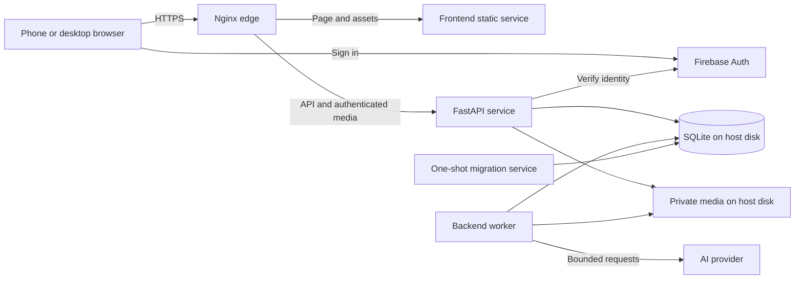
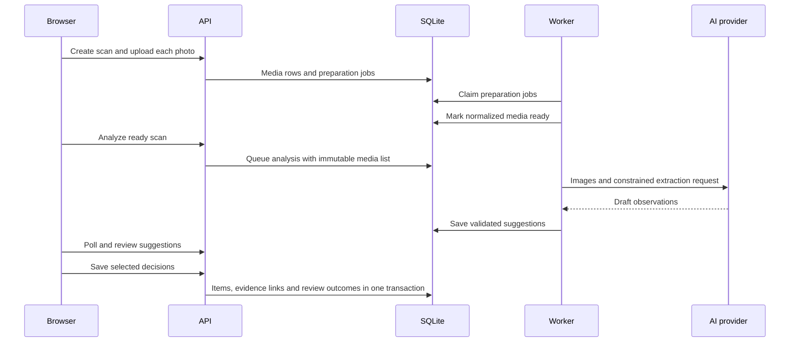

# Application architecture

Use a modular backend with a separate worker process, a browser frontend, and Nginx at the edge. API and worker share application code and the same local database. This keeps responsibilities separate without introducing network services for individual business domains.

## Deployment shape



| Compose service | Responsibility | Persistent access |
| --- | --- | --- |
| `nginx` | TLS termination, routing, body limits, basic rate limits, headers | Certificate files only |
| `frontend` | Serve compiled React assets; development override runs Vite | None |
| `api` | Authenticate, validate requests, enforce rules, serve authorized images, enqueue work | Database and media |
| `worker` | Prepare images, run AI jobs, validate results, commit outputs, bounded cleanup | Database and media |
| `migrate` | Apply schema upgrades once before API and worker startup | Database |

The frontend service can use a small static Nginx image. It has no authentication secrets, database access, or business logic. Keeping it separate from the edge meets the requested frontend service boundary and allows the development server to occupy the same route.

Publish only edge ports. API and frontend addresses are internal Docker DNS names. The worker has no HTTP port. The database is an embedded library accessing a host file, so no host database daemon or database network port is required.

## Source layout

```text
frontend/
  src/features/{auth,inventory,capture,moves,assistant}/
  src/api/                 generated types and authenticated transport
  src/components/          shared presentation components
backend/
  app/domain/              entities, enums, invariants, estimate arithmetic
  app/application/         use cases and boundary protocols
  app/api/                 routes, HTTP schemas and error mapping
  app/adapters/            SQLite, local media, Firebase and AI implementations
  app/worker/              polling and job dispatch
  app/bootstrap.py         dependency composition
  migrations/
  tests/{unit,integration}/
infra/nginx/
tests/e2e/
docs/design/
compose.yaml
compose.test.yaml
```

This is a proposed layout; these application files are not created in the design session. Feature modules may live inside these directories as they grow. Avoid creating empty abstractions and folders solely to match the diagram.

## Dependency direction

Domain logic imports neither FastAPI nor database, Firebase, or model SDKs. Application use cases call domain functions and narrowly scoped interfaces. Adapters implement those interfaces. API routes translate HTTP into use case inputs; worker handlers call the same application layer. `bootstrap.py` is the only place that selects concrete implementations.

Keep HTTP schemas, model response schemas, ORM models, and domain objects distinct where their meanings differ. A model observation with unknown quantity must not be accepted accidentally as a confirmed item. Do not create four duplicate classes for simple values with identical semantics.

FastAPI routers group endpoints; dependency injection supplies the current owner and application services. [FastAPI application structure](https://fastapi.tiangolo.com/tutorial/bigger-applications/)

| Interface | Representative contract | Initial implementation |
| --- | --- | --- |
| `IdentityVerifier` | `verify(token) -> Principal` | Firebase Admin SDK |
| `UnitOfWork` | Transaction-scoped repositories and explicit commit | SQLAlchemy session over SQLite |
| `InventoryRepository` | Read and save items, rooms and boxes within owner scope | SQLAlchemy queries |
| `JobRepository` | Enqueue, claim, finish and inspect durable work | SQLite jobs table |
| `MediaStore` | Write private blobs, open by internal key, delete | Local filesystem |
| `VisionExtractor` | `extract(prepared_images, context) -> ObservationBatch` | OpenAI Responses adapter |
| `InventoryAdvisor` | `advise(snapshot, request) -> Advice` | OpenAI Responses adapter |
| `MoveEstimator` | `estimate(snapshot, assumptions) -> Estimate` | Pure Python calculation |

Use Python protocols for substitutable boundaries. Repositories expose operations the use cases need, not a generic repository framework. Fake AI and identity implementations belong to tests and explicit local development configuration.

## Background jobs

Use one worker with concurrency one. Job kinds are `prepare_media`, `analyze_scan`, `advise_disposition`, `answer_question`, and `generate_plan`. API responses return a job ID immediately. The browser polls every two seconds while active and backs off to ten seconds; stop on terminal state or when the view is hidden.

The worker claims a queued row in a short transaction, records `running`, and releases the transaction before decoding media or calling a provider. It validates output and stores the result plus `succeeded` in one transaction. Jobs carry the input snapshot, model/schema versions, attempt count, timestamps, safe error code, and usage.

At worker startup, jobs left `running` by the previous process become `interrupted`. Queued jobs remain queued. The user can retry an interrupted job explicitly; this avoids silently repeating a potentially paid request. Enforce the single-worker deployment assumption rather than implementing distributed leases. A heartbeat distinguishes a busy worker from a dead one; it is an operational signal, not a second scheduler.

Only rate-limit and explicit transient provider failures receive a bounded retry, with at most two provider attempts in total. Ambiguous timeouts become interrupted or failed with an explicit retry action. Disable overlapping SDK retry loops. No transaction stays open over a provider call, filesystem decode, or sleep.

## Main flows



The worker never promotes observations into canonical inventory. The review use case owns that transaction. Plan generation uses a snapshot captured by the API, so the saved plan identifies exactly which inventory revision and move settings it used.

## Simplicity boundaries

One HTTP API, one database, one worker, one host. Use REST JSON and generated TypeScript types from FastAPI OpenAPI. No GraphQL, event bus, Kubernetes, separate vector index, Celery deployment, or agent orchestration service. If a provider interface changes, tests should catch the translation failure without involving unrelated inventory rules.
